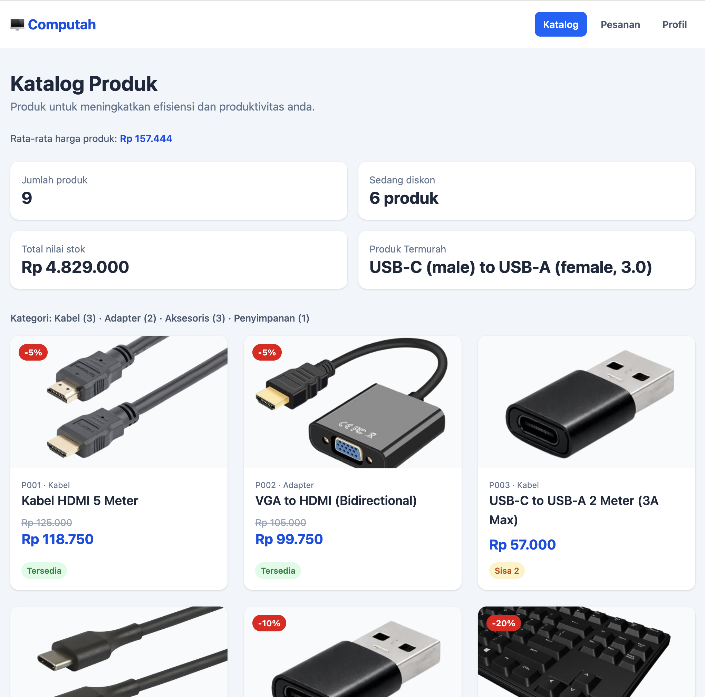
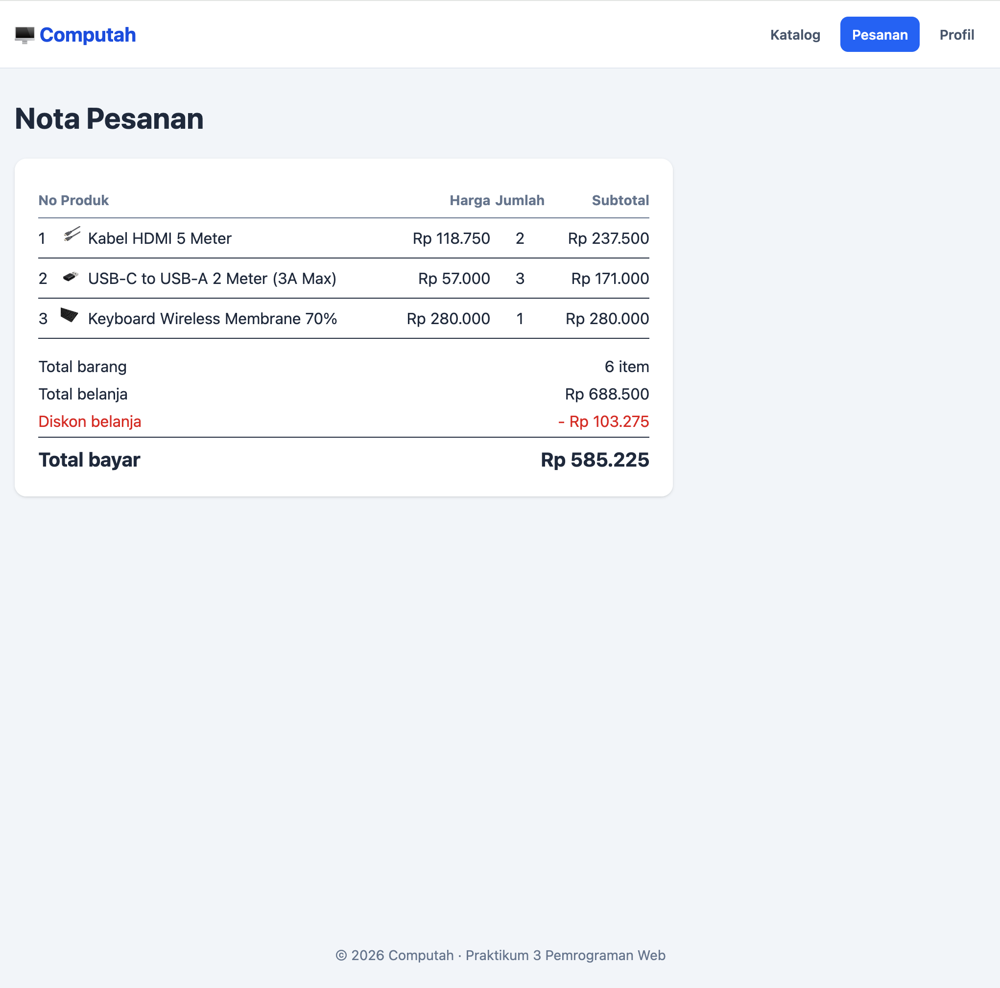
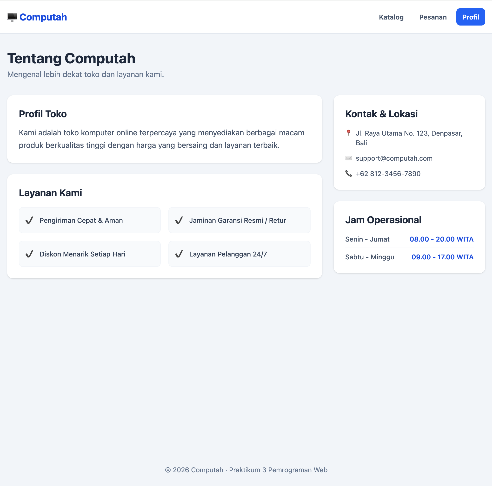

# Praktikum 3 — Katalog Produk Toko Komputer / E-Commerce

**Nama:** Naufal Aradine A.
**NIM:** 2501020107
**Mata Kuliah:** Pemrograman Web  

---

## 📌 Deskripsi Proyek
Proyek ini merupakan aplikasi web katalog produk interaktif yang dibuat menggunakan **PHP Native** dan **Tailwind CSS**. Data produk dikelola secara dinamis menggunakan array multidimensi dan fungsi-fungsi terpisah untuk kalkulasi diskon, status stok, serta ringkasan total nota belanja.

---

## 🛠️ Fitur Utama
1. **Katalog Produk Dinamis:** Menampilkan daftar produk beserta status stok, badge diskon, dan harga akhir.
2. **Layout Custom & Responsive:** Tampilan menggunakan *Sidebar Navigation* untuk kategori dan *Grid System* responsif.
3. **Penyaringan Kategori:** Menampilkan jumlah item per kategori secara terstruktur.
4. **Nota Pesanan:** Perhitungan otomatis subtotal, diskon belanja tambahan, dan kalkulasi total bayar.
5. **Halaman Profil Toko (`tentang.php`):** Informasi operasional dan layanan toko.

---

## ⭐ Tantangan (Pengayaan) yang Dikerjakan
- [✓] **⭐ Produk Termurah:** Menambahkan kotak ringkasan baru berisi nama produk termurah.
- [✓] **⭐ Rata-rata Harga:** Menampilkan rata-rata harga seluruh produk pada katalog.
- [✓] **⭐⭐ Filter Kategori:** Menampilkan hanya produk yang sesuai kategori jika diberikan melalui variabel atau via GET (`...?kategori=NamaKategori`).
- [✓] **⭐⭐ Jumlah per Kategori:** Kalkulasi dan visualisasi jumlah produk berdasarkan kategorinya pada bagian *sidebar*.
- [✓] **⭐⭐⭐ Halaman Tentang Toko:** Halaman profil toko interaktif yang terintegrasi dengan menu navigasi navbar.

---

## 📝 Attribution & Asset Disclaimer

Seluruh aset gambar yang digunakan dalam proyek ini diambil dari sumber publik untuk keperluan edukasi dan praktikum akademis:
- **Generic USB Flashdrive:** [Swivel USB Flash Drive, Black and Silver...](https://www.amazon.in/CleverlyGifted%C2%AE-Swivel-Silver-Portable-Storage/dp/B0FG85V1QF?th=1)
- **Generic Webcam:** [Webcam, High Definition, Built-in Microphone...](https://www.amazon.eg/-/en/Generic-Webcam-Definition-Microphone-Correction/dp/B0DS2S5JGN)
- **HDMI Cable:** [HDMM1](https://www.digikey.com/en/products/detail/startech-com/HDMM1/22260594)
- **Headset:** [Zone Wired for Business: USB Headset with ANC...](https://saledivarfv.click/product_details/14598069.html)
- **USB-A to USB-C:** [6FT Premium USB Type-C Replacement...](https://www.amazon.com/dp/B0F8PP62MG)
- **USB-C to USB-A Converter:** [USB-C to USB-A Adapter 2-Pack...
](https://twraps.com/products/usb-c-to-usb-a-adapter-2-pack-charging-data-usb-2-0)
- **USB-C to USB-C:** [New USB-C authentication spec protects...](https://www.pcworld.com/article/420531/new-usb-c-authentication-spec-protects-against-malware-and-shoddy-chargers.html)
- **VGA to HDMI Converter:** [CONVERTER HDMI TO VGA ADAPTER...](https://shopee.co.id/CONVERTER-HDMI-TO-VGA-ADAPTER-Hdmi-adapter-Konektor-hdmi-Kabel-Hdmi-Kabel-VGA-i.1018275705.23673110648)
- **Wireless Keyboard:** [Generic PC Keyboard](https://www.turbosquid.com/3d-models/generic-pc-keyboard-3d-1206914?dd_referrer=https%3A%2F%2Fwww.google.com%2F)

---

## 🖼️ Screenshot

### I.  Halaman Katalog: 
### II. Halaman Pesanan: 
### III.Halaman Profil: 